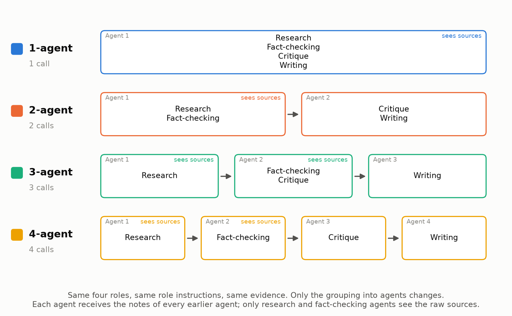

# agent-architecture-lab

**How many AI agents do you actually need?** A controlled experiment that splits the
same four jobs (research, fact-checking, critique, writing) across 1, 2, 3 or 4
LLM agents and measures quality, cost, latency and reliability. A rule fixed in
advance picks the winner.

It runs entirely on the **free Gemini API tier**, and every run is saved to
`results/runs/` so anyone can verify it.



## Quick start

Requirements: Python 3.12+ with [uv](https://docs.astral.sh/uv/), Node 20+, and a free
Gemini API key from [Google AI Studio](https://aistudio.google.com/apikey).

```bash
# 1. Configure (copy and fill in the key)
cp .env.example .env

# 2. Backend
uv sync --extra blog
uv run agent-lab serve            # http://127.0.0.1:8000

# 3. Frontend (second terminal)
cd frontend
npm install
npm run dev                       # http://localhost:5173
```

Open http://localhost:5173 and either:

- **Benchmark**: run the 12 fixed cases (easy → adversarial). The official result
  is all 12 cases × 3 trials × 4 architectures. That is about 360 generator calls
  and 180 judge calls on two Flash-Lite models (about 500 free requests/day each),
  so it fits in one day of free quota. See the
  [free-tier guide](docs/free-tier-guide.md).
- **Custom case**: ask your own question. Evidence comes from a Tavily web
  search (needs `TAVILY_API_KEY`) or from sources you paste.

Results show up live. Each run has a winner banner, leaderboard, charts, a
per-tier breakdown and a side-by-side drill-down with every agent's
intermediate notes.

## Command line

```bash
uv run agent-lab benchmark --trials 3          # same as the UI's official run
uv run agent-lab benchmark --difficulty hard --trials 1
uv run agent-lab list                          # runs and their status
uv run agent-lab resume <run_id>               # continue after a quota pause
uv run agent-lab report <run_id|dir>           # verify summary.json against raw files
uv run agent-lab replay <run_id|dir>           # re-execute offline from the LLM cache
uv run agent-lab blog                          # rebuild docs/blog/how-many-agents.docx
uv run pytest                                  # tests (no API calls)
```

## How it works

| Piece | Where |
|---|---|
| The four architectures (role groupings) | [`src/agent_lab/architectures/definitions.py`](src/agent_lab/architectures/definitions.py) |
| Shared role instructions (identical for every architecture) | [`src/agent_lab/architectures/roles.py`](src/agent_lab/architectures/roles.py) |
| Generic pipeline that builds each agent's prompt | [`src/agent_lab/architectures/pipeline.py`](src/agent_lab/architectures/pipeline.py) |
| Blind rubric judge + blind ranking judge | [`src/agent_lab/evaluation/`](src/agent_lab/evaluation/) |
| Statistics and the winner rule | [`src/agent_lab/analysis/`](src/agent_lab/analysis/) |
| Rate limiting, retries, response cache | [`src/agent_lab/llm/`](src/agent_lab/llm/) |
| Benchmark questions + frozen evidence | [`data/benchmark/`](data/benchmark/) |
| Saved runs (commit these) | [`results/runs/`](results/runs/) |

## Documentation

- [docs/experiment-design.md](docs/experiment-design.md): hypotheses, controls, metrics, the winner rule, threats to validity
- [docs/architectures.md](docs/architectures.md): the four pipelines and the context rule
- [docs/benchmark.md](docs/benchmark.md): the 12 cases and how the traps work
- [docs/free-tier-guide.md](docs/free-tier-guide.md): quotas, timing, pausing and resuming
- [docs/lab-notebook.md](docs/lab-notebook.md): template for recording observations during runs
- [docs/blog-notes.md](docs/blog-notes.md): outline and talking points for the write-up
- [docs/blog/how-many-agents.docx](docs/blog/how-many-agents.docx): the illustrated blog draft (rebuilt from results)

## Why no LangGraph or LangChain?

The pipelines are straight sequences, so a loop is the whole orchestration layer.
Plain Python keeps every prompt visible and every token counted. It also guarantees
no framework-specific system prompts, retries or memory differ between
architectures, which would quietly confound the result. See the blog draft for
the longer argument.
