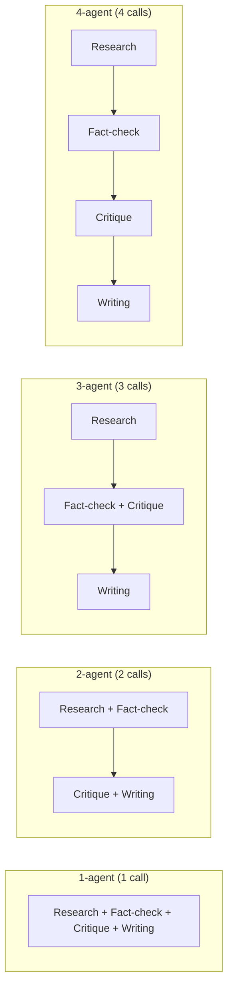

# The four architectures

All four architectures perform **all four roles**, in the same order, using the
**same role instructions** ([`roles.py`](../src/agent_lab/architectures/roles.py)).
The only difference is how many LLM calls (agents) the roles are split across.



## The roles

| Role | Duties | Hands over |
|---|---|---|
| Research | Break the question into sub-questions; extract relevant facts tagged `[S#]`; record disagreements and gaps | A structured research brief |
| Fact-checking | Label each claim SUPPORTED / PARTIAL / UNSUPPORTED / CONTRADICTED; resolve conflicts (newer, more specific, more authoritative); check the question's premise; list claims to exclude | A fact-check report |
| Critique | Judge whether the evidence answers the question; find overgeneralisations and missing caveats; recommend the answer's structure | A critique |
| Writing | Answer directly; cite every claim; preserve uncertainty; say plainly when the sources don't support an answer | The final answer |

Every agent also gets the same **evidence rule**: the sources are the only
evidence, no outside facts, and sources may be wrong or conflicting.

## The context rule

The rule is the same for every architecture:

1. Agents whose roles include **research or fact-checking see the raw sources**.
   Research needs them to extract facts; fact-checking needs them to verify.
2. **Every agent sees all earlier agents' notes** (a shared "blackboard").
3. The agent that includes the **writer** role returns the final answer. The others
   return structured notes for the next agent.

| Architecture | Agent | Sees sources? | Sees notes from |
|---|---|---|---|
| 1-agent | 1: all roles | yes | – |
| 2-agent | 1: research + fact-check | yes | – |
| | 2: critique + writing | **no** | agent 1 |
| 3-agent | 1: research | yes | – |
| | 2: fact-check + critique | yes | agent 1 |
| | 3: writing | **no** | agents 1–2 |
| 4-agent | 1: research | yes | – |
| | 2: fact-check | yes | agent 1 |
| | 3: critique | **no** | agents 1–2 |
| | 4: writing | **no** | agents 1–3 |

This is realistic: in typical multi-agent pipelines the writer works from briefs,
not raw documents. It also means hypothesis H3 (information loss at hand-offs)
can be tested.

## What a prompt looks like

The prompt for agent 2 of the 4-agent pipeline (fact-checking), abbreviated:

```text
You are Agent 2 of 4 in a research team that answers questions using only
provided evidence. The team works in this order:
- Agent 1: Research
- Agent 2: Fact-checking (you)
- Agent 3: Critique
- Agent 4: Writing

Do only your own responsibilities. Other agents handle the rest.

Your responsibilities, in this order:

Fact-checking:
  - Check each claim against the sources and label it SUPPORTED, ...
  ...
Evidence rule (applies to every role): ...
Question: ...
Sources: [S1] ... [S2] ...
Notes from earlier agents:
=== Notes from Agent 1 (Research) === ...
Output: notes for Agent 3 (Critique). Do NOT write the final answer. ...
```

The 1-agent prompt contains the same four duty blocks, stacked, and is told to
return only the final answer. Every prompt and response of a run is stored in
`results/runs/<run>/llm_cache.jsonl`.

## Adding an architecture

Add an `Architecture(...)` to `definitions.py` and append it to `ARCHITECTURES`.
It must cover all four roles in order (an assertion enforces this). Pick a colour
for it in `frontend/src/lib/format.ts` and `src/agent_lab/blog/figures.py`.
