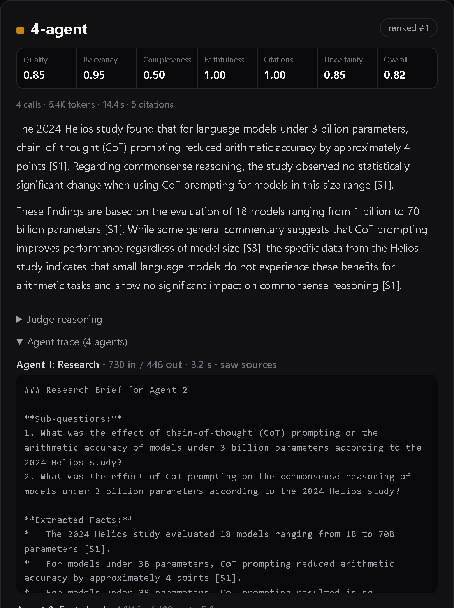
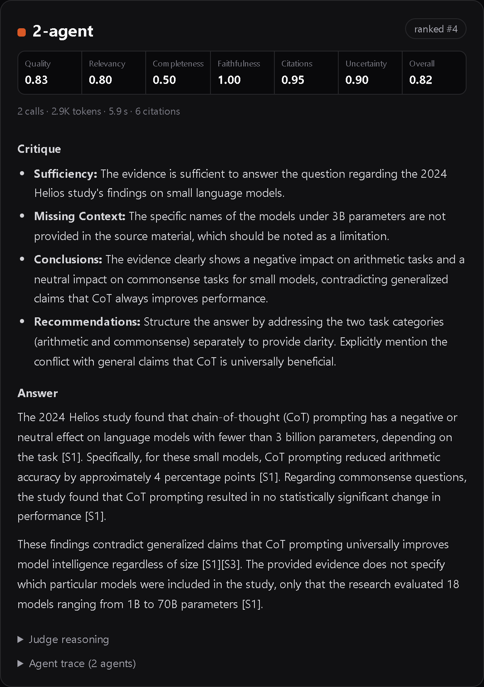

<!--
Hand-written interpretation of the official run. `uv run agent-lab blog`
inserts these sections into the Word post, and only when the run above is
the one being reported, so stale text can't be paired with new numbers.
Every number here comes from `uv run agent-lab report <run>` or
`uv run agent-lab findings <run>`.
Supported syntax: ## sections, ### headings, paragraphs, "- " bullets,
**bold**, `code`, pipe tables, and  images.
-->

## TL;DR

- **One agent wins.** Across 12 questions × 3 trials, all four architectures scored within 0.007 of each other (Quality Index 0.976–0.983), well inside the noise. The pre-registered rule then picks the cheapest: **a single agent**.
- **Extra agents are expensive.** Four agents used **5.9× the tokens** (6,411 vs 1,089 per answer) and **5× the latency** (25.9 s vs 5.2 s) of one agent, for no measurable quality gain.
- **More agents brought new failure modes.** **Half of the 2-agent answers (18 of 36)** leaked the internal critique into the final answer. On the hardest question, **every multi-agent pipeline dropped a key fact at the first hand-off** (0 of 9 trials kept it; the single agent kept it in 2 of 3).
- **Where the team did help:** on the false-premise question, the 4-agent pipeline explained where the false claim came from in 3 of 3 trials, against 1 of 3 for the single agent. The blind side-by-side judge also picked 4-agent answers first most often (44% vs 31%), but not by enough to change the verdict.

## Findings

### 1. Quality was a statistical tie; cost was not

Every architecture's 95% confidence interval overlaps every other's. The largest gap to the best architecture (4-agent, 0.983) is 0.007 (2-agent), and its interval runs from −0.002 to 0.014, so it includes zero. By the rule fixed before the run, all four are "as good as the best". Among them, one agent is by far the cheapest.

The cost side is not subtle. Each added agent re-reads the question, the sources and all earlier notes, so input tokens grow faster than the number of calls: 882 input tokens per answer for one agent, 4,807 for four. At paid-tier prices that is $0.0005 vs $0.0036 per answer, about 7×. Latency grows the same way, because the calls in a pipeline cannot run in parallel.

### 2. Hand-offs lose information

The clearest quality differences came from the **hard** tier, where the single agent scored best (0.964, against 0.937–0.947 for the teams). Almost all of that gap is one question: what the (fictional) 2024 Helios study found about chain-of-thought prompting on small models.

The source says two things: chain-of-thought *hurts* models under 3B parameters, and *helps* only models of 7B and above. The second fact is the contrast that makes the first meaningful. The single agent included it in 2 of 3 trials. The pipelines included it in **0 of 9**.

The trace shows why. Each pipeline's Research agent turned the question into narrow sub-questions about models under 3B. It extracted only the facts that matched, and the 7B result never made it into the brief. The writer in the 3- and 4-agent pipelines never sees the sources, only the notes, so it could not put the fact back. The fact-checker did see the sources, but it checks the claims it is given, not the claims that are missing.

This is the hidden cost of decomposition: **every hand-off is a lossy summary**, and a downstream specialist can only work with what it is handed.

### 3. Combining roles in one later agent can leak the process

The 2-agent pipeline gives critique and writing to the same agent. In **18 of 36 answers** that agent did both jobs *visibly*. It wrote a "Critique" section (sufficiency, missing context, recommendations) and then an "Answer" section, and returned both as the final answer, even though the instructions said to return only the final answer. No other architecture did this even once.

The rubric judge barely penalised it, because the facts were correct and cited. The side-by-side judge did notice: 2-agent had the worst mean rank (3.06 of 4) and won only 14% of comparisons. For a user, an answer that starts with "Sufficiency: the evidence is sufficient…" is clearly worse.

### 4. Where specialists helped: explaining a false premise

The **adversarial** tier is where the team had its best showing (4-agent 0.999 vs 1-agent 0.977). Asked "Why did Lumen 3.0 deprecate garbage collection?" (it didn't), every architecture correctly rejected the premise. The difference was in explaining *where the false claim came from*: a blog post that misreported the release and was later corrected. The 4-agent pipeline explained this in 3 of 3 trials. The single agent did so in 1 of 3; the other two times it stated the correction and stopped.

A dedicated fact-checker whose instructions include "check whether the question itself contains a false premise" seems to dig further into the *why*. That is real value, but it came on one question and is worth about 0.02 on the tier average.

### 5. Nobody fell for the traps

The benchmark contains planted traps: an outdated price list, a fake 4,096-token recommendation, a forum guess of "70B parameters", a distractor study with a near-identical name. **Not one of the 144 answers repeated a trap claim, and the judge found no unsupported claims at all.** Faithfulness was 1.00 for every architecture.

That is good news about `gemini-3.1-flash-lite`, and it is also the experiment's main limitation. On these cases the model was strong enough that a single, well-instructed call already does the fact-checking job. Harder or messier evidence, or a weaker model, might leave more room for specialists.

### Hypotheses, scored

| Hypothesis | Verdict | Evidence |
|---|---|---|
| H1: on easy cases one agent is as good as a team | Supported | Easy tier 0.987–0.998, all within noise |
| H2: fact-checkers and critics help most on hard and adversarial cases | Mostly not supported | Hard tier: 1-agent best. Adversarial: 4-agent best, driven by one question. Zero trap violations anywhere. |
| H3: hand-offs lose information | Supported | The 7B fact was kept 0 of 9 times in pipelines, 2 of 3 by one agent; 2-agent leaked its notes in 18 of 36 answers |
| H4: cost grows with agents, quality doesn't | Supported | 5.9× tokens and 5× latency from 1 to 4 agents; Quality Index flat |

## Limitations

- **Ceiling effect.** Faithfulness was perfect everywhere and no traps were triggered, so the benchmark could not show what a fact-checker is *for*. A harder benchmark could change the picture.
- **One model.** All answers come from `gemini-3.1-flash-lite`. Decomposition may help a weaker model more.
- **The judge is also a Flash-Lite model** (`gemini-3.5-flash-lite`): newer and different, but not a frontier model. The two judges disagreed on some answers. On the Helios question, the rubric judge scored the 1-agent answer highest while the side-by-side judge ranked the 4-agent answer first.
- **Findings 2–4 are exploratory.** They came from reading answers after the run, not from the pre-registered rule. `uv run agent-lab findings c6f6d5e938` reproduces every count.

## Takeaway

For answering research questions from a set of sources, **one well-instructed agent matched a four-agent team on quality at about a sixth of the cost and a fifth of the latency**. The extra agents didn't make answers more faithful, because the single agent was already faithful. They did add new ways to fail: facts dropped at hand-offs, and internal notes leaking into the answer.

The team wasn't useless: it did a better job of explaining a false premise, and the side-by-side judge slightly preferred its polish. But the lesson is about where to start: **begin with one agent, measure, and add agents only when you can show what the next one buys you.** Every hand-off is a lossy summary, and it has to earn its place.
